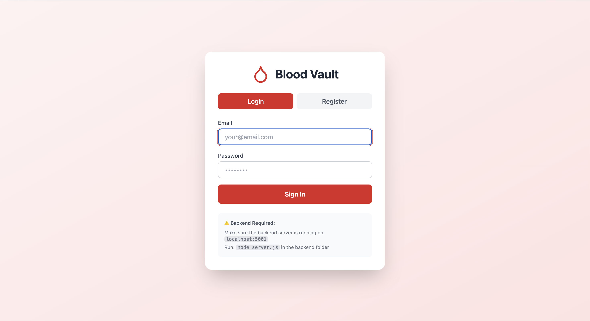
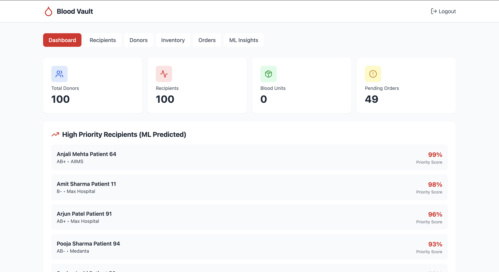
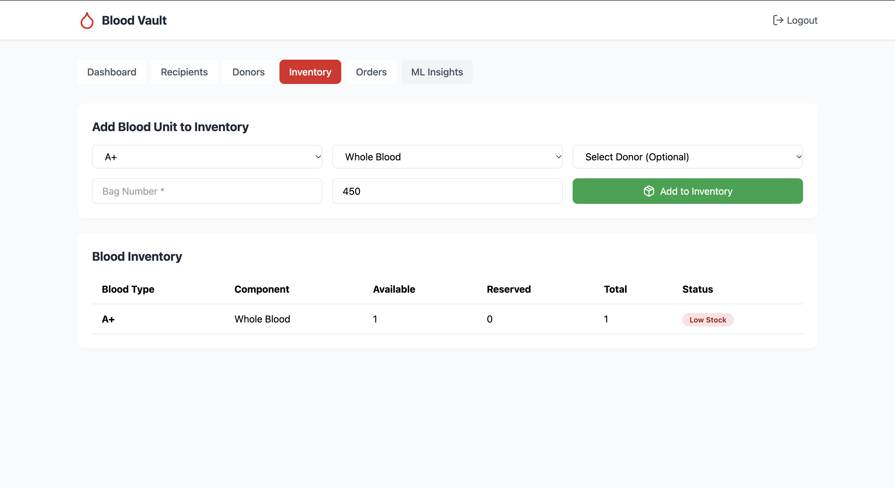
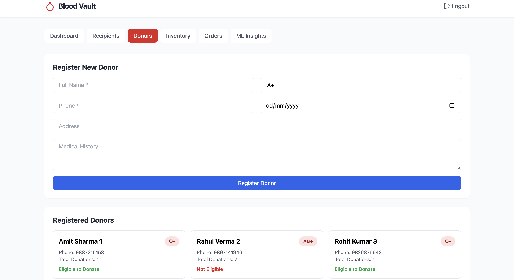
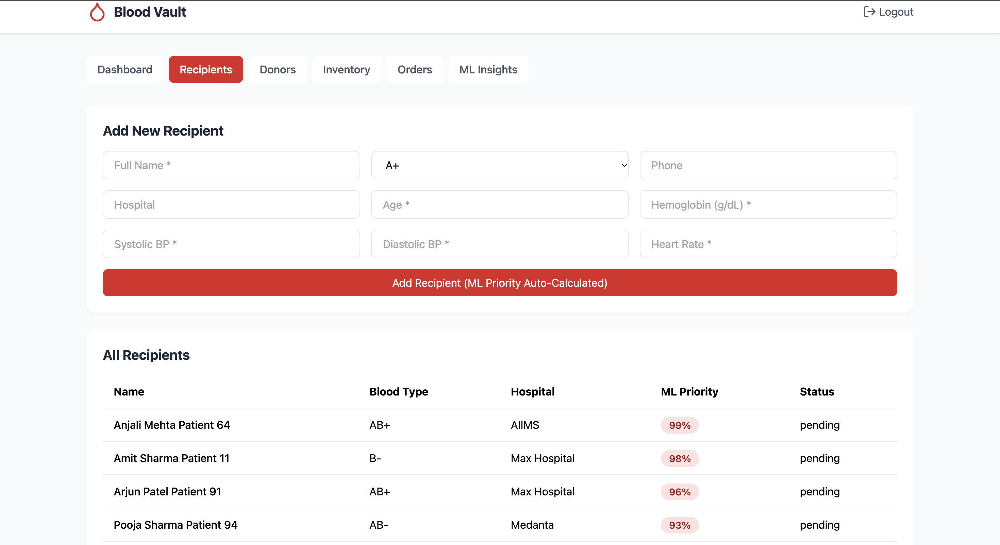
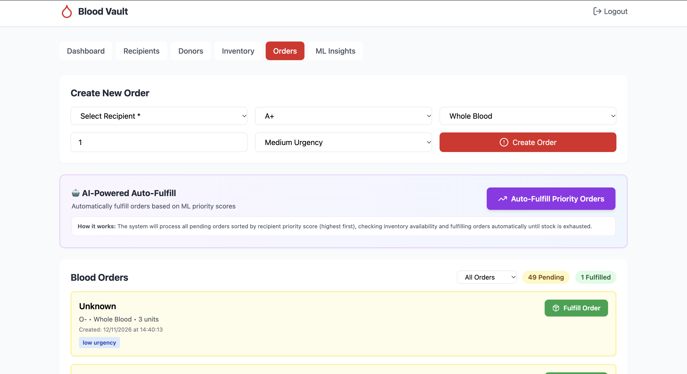

# 🩸 Blood Vault – Blood Bank Management System

Blood Vault is a web-based blood bank management application designed to simplify blood donation management, recipient tracking, blood inventory monitoring, and blood request processing through a centralized platform.

The application combines a React-based frontend with a Node.js and Express backend, using MongoDB for data storage. It also incorporates rule-based algorithms for donor matching, priority scoring, inventory insights, and demand forecasting.

## ✨ Features

- **User Authentication:** Secure registration and login using password hashing and JWT-based authentication.
- **Donor Management:** Manage donor information and eligibility records.
- **Recipient Management:** Maintain recipient information and blood requirements.
- **Blood Inventory:** Track available blood units, blood groups, and components.
- **Blood Requests:** Create and manage blood requests and orders.
- **Order Fulfillment:** Process and fulfill blood orders.
- **Donor Matching:** Rule-based matching of donors with recipient requirements.
- **Priority Scoring:** Rule-based recipient prioritization.
- **Inventory Insights:** Generate inventory-related insights.
- **Demand Forecasting:** Estimate future blood demand using application-defined algorithms.
- **Employee Management:** Manage employee records through the application.

## 🛠️ Technology Stack

| Component | Technologies |
|---|---|
| Frontend | React.js, JavaScript, CSS |
| Backend | Node.js, Express.js |
| Database | MongoDB, Mongoose |
| Authentication | JWT, bcryptjs |
| Environment Configuration | dotenv |
| API Communication | REST API |

## 📁 Project Structure

```text
Blood-Vault/
│
├── backend/
│   ├── .env.example
│   ├── package.json
│   ├── package-lock.json
│   ├── server.js
│   └── seed.js
│
├── frontend/
│   ├── public/
│   ├── src/
│   ├── package.json
│   ├── package-lock.json
│   └── README.md
│
├── .gitignore
└── README.md
```

## 📸 Application Screenshots

### Login Page


### Dashboard


### Blood Inventory


### Donor Management


### Recipient Management


### Blood Requests and Orders



## ⚙️ Installation and Setup

### Prerequisites

Install the following before running the project:

- Node.js and npm
- MongoDB Community Server
- Git

### 1. Clone the Repository

```bash
git clone https://github.com/divy000/Blood-Vault.git
cd Blood-Vault
```

### 2. Set Up the Backend

Navigate to the backend directory:

```bash
cd backend
npm install
```

Create a `.env` file inside the `backend` directory using `.env.example` as a reference.

Configure the following variables:

```env
PORT=5001
MONGODB_URI=mongodb://localhost:27017/blood_vault
JWT_SECRET=your_new_random_secret
NODE_ENV=development
```

Generate a strong random JWT secret rather than using the example value.

Start the backend:

```bash
npm start
```

The backend will run at:

`http://localhost:5001`

### 3. Set Up the Frontend

Open a second terminal and navigate to the frontend directory:

```bash
cd frontend
npm install
npm start
```

The frontend will normally open at:

`http://localhost:3000`

### 4. Database Configuration

Make sure MongoDB is running locally before starting the backend.

The application connects to the database specified by `MONGODB_URI`.

## 🧠 Intelligent Algorithms

Blood Vault includes application-defined algorithms for:

- Donor matching based on blood group compatibility and eligibility.
- Recipient priority scoring.
- Inventory analysis and recommendations.
- Blood demand forecasting.

These features currently use rule-based logic and heuristic calculations. They are not trained or clinically validated machine-learning models.

## 🔐 Security Notes

- Environment variables are stored locally in `backend/.env`.
- Actual environment files are excluded from Git using `.gitignore`.
- Passwords are hashed using bcryptjs.
- JWT is used for authentication.
- Never upload database credentials, private keys, or JWT secrets to GitHub.

## ⚠️ Important Limitations

- This project is intended for educational and demonstration purposes.
- The rule-based algorithms are not clinically validated.
- Priority scores and forecasts must not be treated as medical predictions or clinical recommendations.
- The sample-data seed script deletes existing records from the `donors`, `recipients`, `bloods`, and `orders` collections before inserting new sample data. Use it only with a disposable development database.
- Additional security hardening and production deployment configuration are required before real-world use.

## 🚀 Future Improvements

- Integration with verified blood bank data sources.
- Advanced donor and recipient matching.
- Improved forecasting algorithms using validated datasets.
- Email and SMS notifications.
- Cloud database integration.
- Automated testing and deployment.
- Enhanced security and role-based access controls.

## 👨‍💻 Author

**Divyanshu Singh Parihar**

GitHub: [@divy000](https://github.com/divy000)

---

*Blood Vault – Connecting blood donors, recipients, and inventory management through technology.*